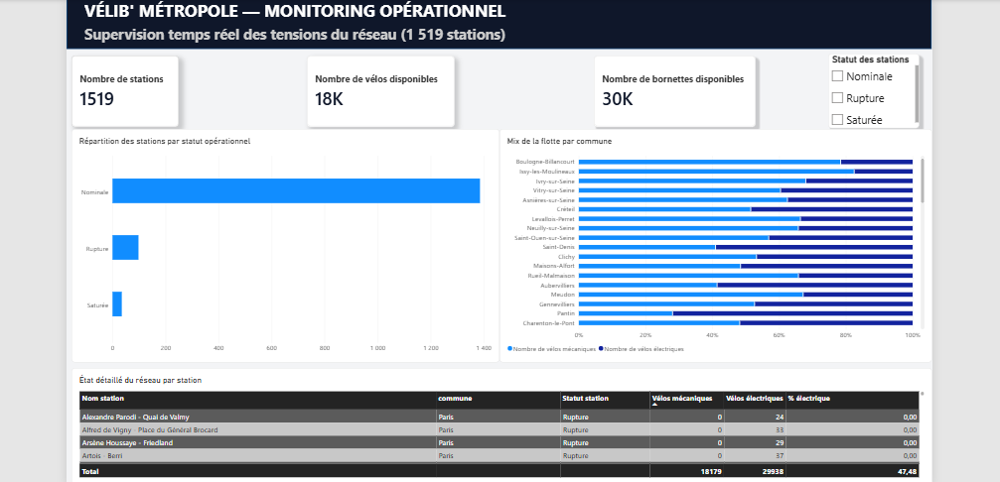

# 🚴 Vélib' Métropole : pipeline ELT et dashboard de disponibilité

Pipeline de données complet sur les **1 519 stations** du réseau Vélib' Métropole : ingestion depuis l'API Open Data Paris (Python), stockage dans PostgreSQL, transformation et tests avec dbt, visualisation dans Power BI.



## 🎯 Objectif

Surveiller la disponibilité du réseau et repérer rapidement :

- les stations **en rupture** (0 vélo disponible) ;
- les stations **saturées** (0 bornette libre) ;
- la répartition **vélos mécaniques / électriques** par commune.

## 📈 Ce que montre le dashboard

Sur le relevé de la capture ci-dessus (ordres de grandeur lus sur le graphique) :

- environ **1 380 stations en statut nominal**, une **centaine en rupture** et une **trentaine saturées** sur 1 519 ;
- le mix mécanique / électrique varie fortement d'une commune à l'autre ;
- un tableau détaillé liste les stations en rupture (nom, commune, vélos mécaniques et électriques) pour un usage opérationnel.

## 🏗️ Architecture

```
API Open Data Paris (JSON)
        │  elt_ingest.py (requests, pandas, sqlalchemy)
        ▼
PostgreSQL : table raw_velib
        │  dbt
        ▼
stg_velib                  → vue de nettoyage et de typage
        ▼
fct_velib_availability     → table de faits : taux de disponibilité,
        │                    % de vélos électriques, statut de la station
        ▼
Power BI (Dashboard.pbix)
```

**Statut de station** (calculé dans `fct_velib_availability`) : `Rupture` (0 vélo), `Saturée` (0 bornette libre), sinon `Nominale`.

**Tests dbt** : `unique` et `not_null` sur `station_id` ; `not_null` sur `availability_rate_pct` ; `not_null` et `accepted_values` (Nominale, Rupture, Saturée) sur `station_status`.

## 🛠️ Stack technique

| Étape | Outil |
|---|---|
| Ingestion | Python (`requests`, `pandas`, `sqlalchemy`) |
| Stockage | PostgreSQL |
| Transformation et qualité | dbt Core (`dbt-postgres`) |
| Visualisation | Power BI Desktop |

## 🚀 Lancer le projet

**Prérequis** : Python 3, PostgreSQL, Power BI Desktop (pour ouvrir `Dashboard.pbix`).

1. **Cloner le dépôt**
   ```bash
   git clone https://github.com/pierreolivierbinet/velib-elt-pipeline.git
   cd velib-elt-pipeline
   ```
2. **Installer les dépendances Python**
   ```bash
   pip install -r requirements.txt
   ```
3. **Créer la base PostgreSQL** `velib_db`. Le script d'ingestion se connecte en local avec `postgres` / `postgres` ; modifie la ligne `create_engine(...)` dans `elt_ingest.py` si ta configuration est différente.
4. **Configurer dbt** : crée un profil `velib_dbt` dans ton fichier `~/.dbt/profiles.yml` (exemple à adapter) :
   ```yaml
   velib_dbt:
     target: dev
     outputs:
       dev:
         type: postgres
         host: localhost
         port: 5432
         user: postgres
         password: postgres
         dbname: velib_db
         schema: public
         threads: 1
   ```
5. **Charger les données brutes**
   ```bash
   python elt_ingest.py
   ```
6. **Transformer et tester avec dbt**
   ```bash
   cd velib_dbt
   dbt run
   dbt test
   ```
7. **Ouvrir `Dashboard.pbix`** dans Power BI Desktop et pointer la source vers ta base PostgreSQL (table `fct_velib_availability`).

## 📁 Structure du dépôt

```
velib-elt-pipeline/
├── elt_ingest.py            # ingestion API → PostgreSQL (table raw_velib)
├── velib_dbt/               # projet dbt
│   └── models/
│       ├── staging/stg_velib.sql
│       └── marts/           # fct_velib_availability.sql + schema.yml (tests)
├── Dashboard.pbix           # dashboard Power BI
├── dashboard_preview.png    # aperçu du dashboard
├── requirements.txt
└── README.md
```

## ⚠️ Limites et pistes d'amélioration

- Chaque exécution de `elt_ingest.py` **remplace** la table `raw_velib` : le dashboard reflète le dernier relevé chargé, sans historique.
- L'ingestion est lancée à la main (pas de planification).
- Pistes : planifier l'ingestion, historiser les relevés pour suivre l'évolution dans le temps, ajouter des tests de cohérence entre capacité, vélos et bornettes.

## 🧭 Démarche

Projet réalisé pour apprendre l'Analytics Engineering avec dbt. Je me suis fait accompagner par une IA comme mentor, ce qui m'a permis de comprendre concrètement la chaîne complète de la donnée : staging, tables de faits, tests dbt et visualisation.

## 👤 Auteur

**Pierre-Olivier Binet** : Master 2 Data Analytics (Ingémédia, Université de Toulon)
[LinkedIn](https://www.linkedin.com/in/pierre-olivier-binet/) · [Portfolio](https://portfolio-pierreolivier-binet.netlify.app) · pierro.bnt@gmail.com
