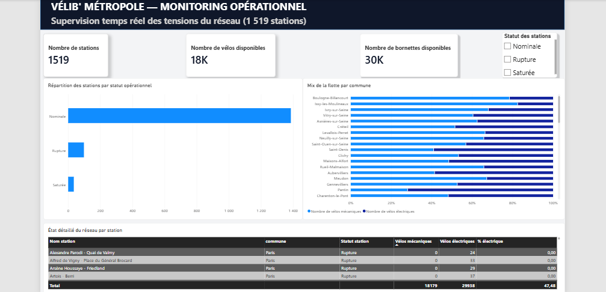

# 🚴 Mon Premier Pipeline ELT : Analyse du Réseau Vélib' Métropole

## 📌 Présentation du projet
Ce projet est mon **tout premier pipeline de données complet (ELT)**. Il ingère, transforme et visualise la disponibilité en temps réel des **1 519 stations** du réseau Vélib' de la Métropole du Grand Paris.

> 💡 **Note d'apprentissage** : Pour ce premier projet dbt et pipeline complet, je me suis fait accompagner par une IA comme mentor. Cette démarche m'a permis de comprendre concrètement les concepts d'Analytics Engineering (Staging, Marts, tests dbt) et de maîtriser la chaîne globale de la donnée.

---

## 📊 Dashboard Power BI



Le tableau de bord permet de surveiller :
* **Les tensions du réseau** : Identification instantanée des stations en *Rupture* (0 vélo) et *Saturées* (0 bornette libre).
* **Le mix de la flotte** : Répartition des vélos mécaniques vs vélos électriques par commune.
* **L'état détaillé** : Vue tabulaire pour la gestion opérationnelle.

---

## 🛠️ Stack Technique
* **Ingestion** : Python (`requests`, `pandas`, `sqlalchemy`)
* **Stockage** : PostgreSQL
* **Transformation & Qualité** : dbt Core (`dbt-postgres`)
* **Visualisation** : Power BI Desktop (`Dashboard.pbix`)

---

## 🏗️ Architecture du Pipeline

1. **Extraction** : Récupération des données brutes JSON depuis l'API Open Data Paris (`elt_ingest.py`).
2. **Stockage** : Chargement dans PostgreSQL (`raw_velib`).
3. **Transformation dbt** :
   * `stg_velib` : Vue de nettoyage et de typage des données.
   * `fct_velib_availability` : Table de faits calculant les taux de disponibilité, % d'électrification et statuts d'alerte.
   * **Tests** : Validation dbt (`unique`, `not_null`).
4. **Visualisation** : Connexion de Power BI à la table finale dbt.

---

## 🚀 Comment lancer le projet localement ?

1. **Exécuter l'ingestion de la donnée brute** :
   ```powershell
   python elt_ingest.py